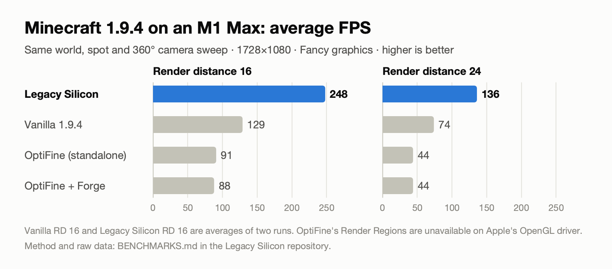

# Legacy Silicon

Sodium-style performance mod for Minecraft **1.9.4** on **Legacy Fabric**, built for **Apple Silicon Macs** (M1 / M2 / M3 / M4). It roughly doubles FPS over vanilla, and it looks like vanilla: nothing lowers resolution, render distance or quality.



**Beta:** so far tested on one Mac (M1 Max). Reports from other Macs and PCs are very welcome; use the Performance report issue template.

## Install (Prism Launcher)

**One-click:** download `legacy-silicon-<version>-prism-instance.zip` from the [latest release](https://github.com/z33rs/legacy-silicon/releases), then in Prism choose **Add Instance → Import** and pick the zip. Prism picks Java 8 for you (on Apple Silicon it uses an arm64 Java, no Rosetta).

**Manual:** install Legacy Fabric for 1.9.4 ([legacyfabric.net](https://legacyfabric.net/downloads.html)), use an **arm64 Java 8** on Apple Silicon (for example Azul Zulu 8), and put `legacy-silicon-<version>.jar` in the `mods` folder.

Every optimization can be switched off in `config/legacysilicon.properties` (created on first launch).

## Results

MacBook Pro M1 Max, 1728×1080, Fancy graphics, dense forest. Same server, spot, camera sweep and Java settings for every setup ([full method and raw data](BENCHMARKS.md)):

| Setup | RD 16 | RD 24 |
|---|---|---|
| Vanilla 1.9.4 | 128–131 FPS | 74 FPS |
| OptiFine 1.9.4 (Forge or standalone) | 88–91 FPS | 44 FPS |
| **Legacy Silicon** | **245–251 FPS** | **136 FPS** |

On Apple Silicon, OptiFine's batching ("Render Regions") is disabled because Apple's OpenGL driver lacks `ARB_copy_buffer`. Legacy Silicon's batching doesn't need it.

## What it does

| Optimization | Output vs vanilla | Config key |
|---|---|---|
| **Region batching.** Chunks are grouped into 8×4×8 regions sharing one GPU buffer per render layer, and drawn with one `glMultiDrawArrays` per region instead of one draw per chunk. On Apple's driver each draw costs about 1 µs, so this cuts the chunk draw loop by about 75%. | Same geometry. Positions are stored relative to the region, so about 0.02–0.08% of pixels per frame differ by last-digit rounding, as isolated single pixels on block edges. Water and glass keep vanilla's exact back-to-front order. | `regionBatching` |
| **Visible-chunk search.** Vanilla's flood fill rewritten with cached see-through masks and integer neighbour lookups. | **Identical.** The same chunk list in the same order, verified against vanilla on tens of thousands of frames. | `fastTerrainSetup` |
| **Camera-chunk scan cache.** Vanilla rescans 4,096 blocks every time the view changes; the result is now reused until a block in that chunk changes. | **Identical** (verified on every test frame). | `fastTerrainSetup` |
| **Entity pass chunk cache.** One world-chunk lookup per column per frame instead of per section. | **Identical.** | `fastTerrainSetup` |
| **Per-chunk draw path** (used when region batching is off): 3 fewer driver calls per chunk. | **Pixel-identical.** | `fastChunkDraw` |
| `BufferBuilder` doubling growth. Also fixes a vanilla bug where a second grow on the per-vertex path overflows. | **Byte-identical.** | `fastBufferGrowth` |
| Translucent quad sort with primitive keys instead of boxed `Integer[]`. | **Byte-identical.** | `fastTranslucentSort` |
| Startup check that Java and the LWJGL/OpenAL/jinput natives are arm64 (not Rosetta). | — | `nativesDir` |

Config file: `<instance>/.minecraft/config/legacysilicon.properties` (created on first launch).

Region batching forces the VBO render path on, even if "Use VBOs" is off in video settings.

## Build

Any JDK 21+ runs the build; the mod itself targets Java 8.

```bash
./gradlew build             # -> build/libs/legacy-silicon-<version>.jar
```

`gradle-env.sh` points Gradle at Prism's bundled JDK if you don't have one installed.

## Automated test (dev only)

Start a local vanilla 1.9.4 server on `127.0.0.1:25565` with `online-mode=false`, `gamemode=3` and the player `LSTest` opped. Then:

```bash
./gradlew runClient -PautoTest -PautoTestDistances=16,24
```

At each render distance it:
- waits for every chunk to be built;
- runs a **pixel test**: renders the same frame vanilla / mod / vanilla and compares every pixel, saving diff images;
- verifies the **visible-chunk search** against vanilla every frame, holding chunk publications so both see the same world;
- times each GL call category;
- runs the **A/B benchmark** and the vanilla profiler.

`-PautoTestMode=fly` instead flies through loading terrain and measures hitches. `-PautoTestJfr` records a Java Flight Recorder profile.

Results go to `run/autotest-results.txt` and images to `run/screenshots/`. `tools/DiffClusters.java` groups differing pixels into clusters, to confirm they are isolated rounding pixels rather than missing geometry.

## Benchmarking against vanilla and OptiFine

`tools/lsbench` is a loader-agnostic Java agent plus a Prism-driven runner that measures any setup (vanilla, Forge, OptiFine, Legacy Fabric) the same way. See [BENCHMARKS.md](BENCHMARKS.md).

## Known limitations

- Region batching is not bit-identical (see above). Set `regionBatching=false` for a pixel-exact (but slower) path.
- Apple's legacy GL driver has no `ARB_copy_buffer`, so region storage grows by adding pages, never by copying. GPU memory for chunk storage is about 2× the mesh size (for example ~340 MB at RD 16, ~1 GB at RD 24).
- Vanilla race (not caused by the mod): a cancelled chunk build's buffer can be reused while its upload is queued. The mod handles partial uploads safely and never lets an upload error crash the game.
- Display-list mode (VBOs off) isn't optimized; region batching always uses VBOs.
